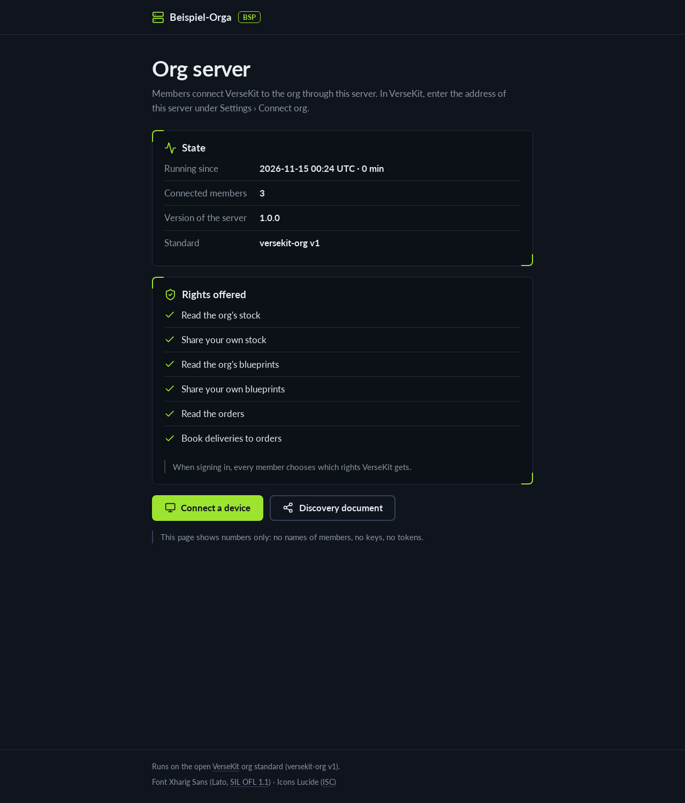
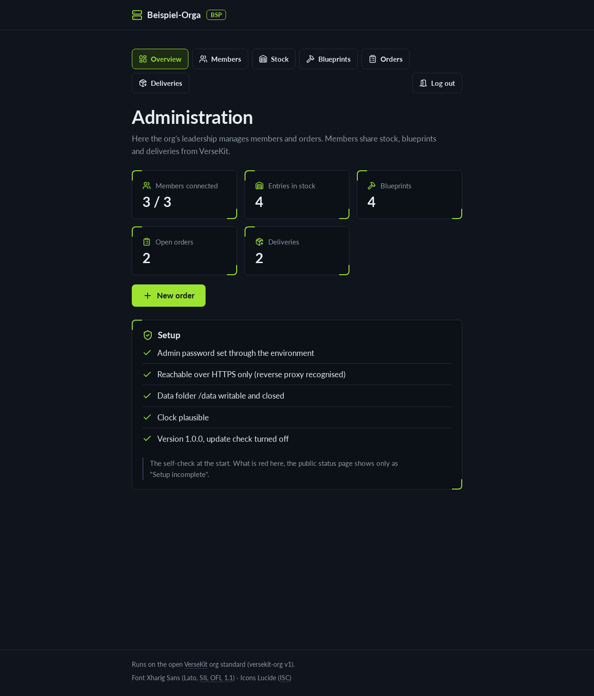

<!-- SPDX-License-Identifier: GPL-3.0-only -->

# Hosting the org server yourself – step by step

This guide is for orgs without an own panel and for people setting up something like this for the first time. At the end the VerseKit org server runs at your place, your members connect VerseKit to it, and the org's leadership manages it in the browser. Deutsch: [selbst-hosten.md](selbst-hosten.md).

If you already have an own panel with a database, you do not need this server: build the open standard into your panel, see [README.en.md](README.en.md#connecting-your-own-panel).

## What you need

- A machine that runs all the time and has Docker: a small rented server (from about 4 € a month), a NAS (UGREEN, Synology) or Unraid. amd64 and arm64 both work.
- A domain or subdomain such as `orga.your-site.org` that you can point at this machine.
- About 30 minutes.

The server is set up securely by default. It creates the admin password itself on the first start. Without HTTPS it starts only in an explicit test mode. You switch nothing off, you only fill in what is asked.

## Way A: rented server with Caddy (recommended)

Caddy stands in front of the org server and fetches the HTTPS certificate by itself. You take care of no certificates.

1. **Point the domain.** At the provider of the domain, create an A record (IPv4) and, if the server has one, an AAAA record (IPv6) for `orga.your-site.org` with the address of the rented server.
   *What you should see now:* `ping orga.your-site.org` answers with the address of your server (this may take a few minutes).
2. **Install Docker.** On the rented server (Debian or Ubuntu): `curl -fsSL https://get.docker.com | sh`.
   *What you should see now:* `docker compose version` names a version.
3. **Create a folder and get the files.** `mkdir orga && cd orga`, then put [`docker-compose.caddy.yml`](docker-compose.caddy.yml) and [`config.example.json`](/crates/versekit-orgserver/config.example.json) into it; rename the second to `config.json`.
4. **Fill in.**
   - Create a file `.env` with the line `VERSEKIT_ORG_DOMAIN=orga.your-site.org`.
   - In `docker-compose.caddy.yml` the name and tag of the org.
   - In `config.json` an `id`, a name and an own key of at least 16 random characters per member. `openssl rand -base64 18` makes a key. Every member gets only their own key. The two sample members of the template have no key on purpose: replace them with your own, or the server does not start.
   - Make the files readable for you only: `chmod 600 .env`, then `sudo chown 65532:65532 config.json && sudo chmod 600 config.json` (65532 is the user the org server runs as inside the container). `config.json` holds the keys of all members in plain text.
5. **Start.** `docker compose -f docker-compose.caddy.yml up -d`.
   *What you should see now:* `docker compose -f docker-compose.caddy.yml ps` shows both containers "running", the org server "healthy" after half a minute.
6. **Open the status page.** In the browser `https://orga.your-site.org`.
   *What you should see now:* the status page with the name of your org and the lock in the browser.
   
7. **Get the admin password.** `docker compose -f docker-compose.caddy.yml exec orgserver versekit-orgserver --admin-password`. Keep the password in a password manager.
8. **Open the administration.** `https://orga.your-site.org/admin`, type the password.
   *What you should see now:* the overview with the card "Setup", every point green.
   
9. **Connect VerseKit.** In VerseKit under **Settings › Connect org** enter the address `https://orga.your-site.org`, confirm the code on the confirmation page with your own key.
   *What you should see now:* VerseKit shows "Connected to … as …", the administration counts one connected member.

## Way B: NAS or Unraid

A NAS usually stands at home behind the router. For members to reach it from outside, it needs HTTPS and a forwarding in the router – only for Caddy, never for the org server itself.

- **With Caddy on the NAS:** take `docker-compose.caddy.yml` as in way A. Forward the ports 80 and 443 in the router to the NAS. If the NAS itself uses 80 or 443 already, take the reverse proxy of the NAS (next point).
- **With the reverse proxy of the NAS:** take `docker-compose.yml` (the org server listens only on `127.0.0.1:8080`) and point `https://orga.your-site.org` in the reverse proxy of the NAS at `http://127.0.0.1:8080`, with a certificate from Let's Encrypt. For that the router forwards 443 to the NAS, and the web server of the NAS answers from the internet. Make sure that then only `orga.your-site.org` is reachable and never the login page of the NAS itself (firewall rule of the NAS, own host name), and turn on two-factor login for the accounts of the NAS.
- **Folder of the NAS:** do not put the folder with `config.json` and `.env` into a share other users reach through the file manager or a network drive.

### UGREEN (UGOS)

1. In the app **Docker** under **Project** create a new project, choose an own empty folder.
2. Paste the content of `docker-compose.caddy.yml` as the compose file. UGOS reads only `docker-compose.yaml`; if you put the files there by hand, the file has that name.
3. Put `config.json` and `.env` into the same folder (file manager of the NAS).
4. Start the project. *What you should see now:* both containers run, the org server shows "healthy".

### Synology (Container Manager)

1. **Container Manager › Project › Create**, project name `versekit-orga`, choose an own folder.
2. "Create docker-compose.yml" and paste the content of `docker-compose.caddy.yml` or `docker-compose.yml`.
3. Put `config.json` and `.env` into the folder with File Station.
4. With the reverse proxy of DSM (**Control Panel › Login Portal › Advanced › Reverse Proxy**): source `HTTPS`, `orga.your-site.org`, port 443; destination `HTTP`, `localhost`, port 8080. Nothing more is needed under "Custom Header".

### Unraid

1. Install the plugin **Docker Compose Manager** from the Community Applications.
2. In the tab **Docker** under "Compose" add a new stack, paste the content of `docker-compose.caddy.yml`, put `config.json` and `.env` into the folder of the stack.
3. **Compose Up**. *What you should see now:* both containers run.

> The click paths above describe UGOS, Synology DSM 7.2 and Unraid with Compose Manager; depending on the version menu items are named slightly differently.

## Adding and removing members

Members are in `config.json`: `id` (fixed, never change it), name, key. After a change `docker compose up -d --force-recreate orgserver`. Whoever disappears from `config.json` can no longer log in. In the administration "Disconnect" only ends the current login; with their key the member can log in again.

## Members' portal with Discord (from 1.1.0)

In the portal at `https://orga.your-site.com/portal` your members see the org's stock, blueprints, orders and deliveries in the browser. They log in with their Discord account. Only who is on your org's Discord server and holds a role in the portal gets in. VerseKit itself still connects as above with code and key; the portal changes nothing about it.

Without the three Discord settings the portal is off. You do not have to turn it on.

### Who may do what

| Role | May |
|---|---|
| Member | see stock, blueprints, orders and deliveries |
| Logistics | also create, edit and close orders, confirm deliveries |
| Lead | everything, also disconnect connected members, give access to the portal, settings |

The admin password at `/admin` stays the emergency access: for the setup and when Discord fails. It may do everything the lead may.

### Step 1: create a Discord application

The application belongs to your org. It is only there for the login and needs no bot.

1. Open <https://discord.com/developers/applications> in the browser and log in with the Discord account of the org's leadership.
2. **New Application**, as the name for example the name of your org, accept the terms, **Create**.
   *What you should see now:* the page **General Information** of your new application.
3. On the left open **OAuth2**.
4. Under **Redirects** click **Add Redirect** and enter exactly this address (your domain instead of `orga.your-site.com`), then **Save Changes**:
   `https://orga.your-site.com/portal/callback`
   It must match character for character: `https`, no slash at the end. The administration shows it under **Settings › Redirect address** to copy.
5. On the same page copy the **Client ID** (**Copy**).
6. Under **Client Secret** click **Reset Secret**, confirm, copy the secret. Discord shows it this one time only. It belongs into the file `.env` only, never into a chat.
7. **Public Client** stays off. You do not tick any scopes: the server asks only for `identify` (who are you) and `guilds.members.read` (are you on our server, which roles do you hold) by itself.

> The menu names of the Discord developer portal are from November 2026; Discord changes them now and then.

### Step 2: get the server id and the role ids

1. In Discord, the cog at the bottom left (**User Settings**) › **Advanced** › turn on **Developer Mode**.
2. Right-click the icon of your org's server in the left bar › **Copy Server ID**.
3. For the roles: **Server Settings › Roles**, right-click a role › **Copy Role ID**. Note one role each for member, logistics and lead (or several).

### Step 3: enter them into the file `.env` and restart

Three lines into the file `.env` next to the compose file, with your values:

```
VERSEKIT_ORG_DISCORD_CLIENT_ID=123456789012345678
VERSEKIT_ORG_DISCORD_CLIENT_SECRET=the-secret-of-step-1
VERSEKIT_ORG_DISCORD_GUILD_ID=876543210987654321
```

Then `docker compose up -d` (with Caddy: `docker compose -f docker-compose.caddy.yml up -d`). The templates already hand the three values on to the org server.

*What you should see now:* the status page has a button **Members' portal**. If one of the three values is missing, the server does not start and names the missing one in the log.

### Step 4: map the roles

1. Open `https://orga.your-site.com/admin` with the admin password, tab **Settings**.
2. Under **Roles from Discord** enter the role ids of step 2: one or several each for lead, logistics and member, separated by spaces. Whoever holds several roles gets the highest. **Save**.
3. Only tick **Every member of the Discord server is a member in the portal** if there are no guests on your Discord server. Else guests see stock and blueprints too.

*What you should see now:* the card **Setup** of the overview says "Members' portal on" in green.

### Step 5: log in

Everyone opens `https://orga.your-site.com/portal`, clicks **Log in with Discord** and confirms at Discord. Then they see the pages their role allows. From now on the lead logs in with Discord as well.

Whoever holds no fitting role yet sees "not let in yet". The lead finds them under **Access** and gives a role by hand there, or gives them the fitting role in Discord (counts from their next login).

### Managing access

- **Access** shows everyone who logged in, with the role, where it comes from and the last login.
- **By hand** any role can be set. **Blocked** keeps someone out whatever Discord says and acts at once, also in an open session.
- **Forget** deletes the entry. If the person logs in again, they show again; whoever should stay out had better stay blocked.
- Another person of the lead or the emergency access changes your own role.
- A login lasts at most 8 hours and ends after 2 hours without a click. New roles in Discord count from the next login.

### What the portal keeps of Discord

Only the Discord id, the display name, the user name, the role ids on your server and the time of the first and last login, in `state.json` in the data folder. The server uses the access token of Discord once to ask for the membership and hands it back at once. Whoever is not on your server is not stored at all.

### Trying out without HTTPS

In the test mode (`VERSEKIT_ORG_TESTBETRIEB: "1"`, address `http://127.0.0.1:8080`) the portal runs without HTTPS too. In the Discord application you then add `http://127.0.0.1:8080/portal/callback` as a second redirect. Never for real members.

## Keeping it up to date

The templates use the image `ghcr.io/xharig/versekit-orgserver:1`. `:1` gets every update of line 1 (new features, fixes), but never a version 2 that breaks something. Whoever wants to confirm every change by hand puts in a fixed version such as `:1.1.0`. `:latest` always follows the newest version, also across a jump to 2; we do not recommend it.

The administration shows "Update available: x.y.z" with a link to the changes. For that the server asks GitHub at most once a day for the tags `orgserver-v…`, without sending anything about your org; GitHub sees only the address of your server and its version. `VERSEKIT_ORG_UPDATE_CHECK: "0"` turns it off.

- **Command:** `docker compose pull && docker compose up -d`.
- **UGOS:** in the app Docker pull the image of the project again and restart the project; depending on the version UGOS offers its own button or automatic updates for it.
- **Synology:** **Container Manager › Project**, choose the project, **Action › Build** pulls the new image (before that **Image › Update** when shown).
- **Unraid:** **Update Stack** in the Compose Manager.
- **Portainer:** **Stacks**, choose the stack, **Update the stack** with "Re-pull image".
- **Watchtower (optional):** if you use Watchtower already, give the org server the label `com.centurylinklabs.watchtower.enable: "true"` and start Watchtower with `--label-enable`; it then updates only containers with this label.

**Data move by themselves.** When a new version needs a new data format, the server first backs up to `backup-<time>/` in the data folder at the start and then moves the data. The log names both.

**From 1.0.0 to 1.1.0:** the data format goes up to 3. After the first start with 1.1.0, 1.0.0 no longer starts on these data; the way back is only the backup the update makes.

**Back to the old version.** Pin the old version in the compose file (such as `:1.0.0`). If it does not know the newer data, it does not start and says why in the log. Then restore the backup (see below, take the backup `backup-<time>/` of the update) and `docker compose up -d`.

## Backup and restore

- **Back up:** `docker compose cp -a orgserver:/data ./backup-$(date +%F)`. Keep `config.json` and `.env` with it.
- **Restore:** `docker compose stop orgserver`, then `docker compose cp -a ./backup-2026-11-14/. orgserver:/data`, then `docker compose start orgserver`. `-a` keeps owner and rights, so the server can read its files again.
- **With Caddy (way A):** put `-f docker-compose.caddy.yml` after `docker compose` in every command, also for `pull` and `up`.

The backup holds the admin password, the logins (only as hashes) and the names and role ids of the portal. Keep it where only you get at it.

## Checking where the image comes from

Every image is built on GitHub from the public source and carries a build provenance. Check it with the GitHub command line: `gh attestation verify oci://ghcr.io/xharig/versekit-orgserver:1 --repo Xharig/VerseKit`. *What you should see:* "Verification succeeded".

## Troubleshooting

| What you see | Why | What helps |
|---|---|---|
| In the log: `public_url is http: only in the test mode` | The address starts with `http://`. | Enter `https://`. Only for trying out on your own computer: `VERSEKIT_ORG_TESTBETRIEB: "1"`. |
| In the browser: "This server answers only over HTTPS" | You call the server without the reverse proxy, or the proxy does not report HTTPS. | Call it with `https://`. For nginx add `proxy_set_header X-Forwarded-Proto $scheme;`. |
| Status page: "Setup incomplete" | The self-check found a fault. | In the administration the card "Setup" shows what is red and why. |
| Caddy: no certificate | The domain does not point at the server yet, or port 80/443 is closed. | Check with `ping`, open the ports in the router or in the firewall of the provider. |
| In the log: `state.json has format …, this server … knows formats up to …` | An older image runs on newer data. | Start the newer image or restore the backup of the update. |
| In the log: `cannot read config.json` | `config.json` is missing or lies elsewhere. | Put the file next to the compose file, with exactly that name. |
| VerseKit: "The key is wrong" | A wrong key when confirming. | Take the key from `config.json`; after five mistakes the code is void, connect again. |
| Administration: "Too many wrong passwords" | Five wrong passwords. | Wait (a minute, longer after that, at most 15 minutes), then get the password with `--admin-password`. If it does not stop, someone else is trying: `docker compose restart orgserver` lifts the lock, then look at the log of the reverse proxy. |
| In the log: `the portal needs all three Discord settings, missing: …` | One of the three Discord lines is missing in `.env`. | Add the line named, or take all three out (then the portal stays off). |
| At Discord: "Invalid OAuth2 redirect_uri" | The redirect in the Discord application does not match exactly. | Enter the address of **Settings › Redirect address** in the Discord application under **OAuth2 › Redirects**, character for character. |
| Portal: "Discord did not confirm the login" | Mostly a wrong or reset client secret. | The log names the reason. Set the secret anew in the Discord application, put it into `.env`, restart. |
| Portal: "not on the org's Discord server" | The person is not on your server, or has not accepted its rules yet; or the server id is wrong. | Invite them, let them accept the rules; check `VERSEKIT_ORG_DISCORD_GUILD_ID`. |
| Portal: "Too many logins just now", for a longer time | Someone calls the login over and over (at most 500 open logins in 10 minutes). | Look into the log of the reverse proxy; slow down `/portal/login` there (a Cloudflare rule for example). `docker compose restart orgserver` empties the queue. |
| Portal: "not let in yet" | None of their Discord roles is mapped. | Give a role by hand under **Access**, or map the role under **Settings**. |
| In the log: `the key of member m1 is shorter than 16 characters` | A member has no own key, a sample member of the template for example. | Make a key with `openssl rand -base64 18` and put it in, or delete the member. |

## What you should never do

- **Open port 8080 to the internet.** The org server speaks plain HTTP. At most Caddy (80 and 443) is opened, never the org server.
- **Use the test mode for real members.** `VERSEKIT_ORG_TESTBETRIEB` is only for trying out on your own computer.
- **Share the admin password or write it into a chat.** Every person of the leadership gets it only personally, best through a password manager.
- **Give a member the key of another.** Every key belongs to exactly one member.
- **Pass on the client secret of the Discord application.** Whoever has it can pose as your application. If it got out anyway: **Reset Secret** in the Discord application, new into `.env`, restart.
- **Turn on "every member of the Discord server" while there are guests on the server.** Then they see stock and blueprints too.
- **Put the data folder or backups in a public place** (cloud share, web folder). They hold the password and the logins.
- **Hang the Docker socket into a container** (`/var/run/docker.sock`), except for a tool you trust fully.
