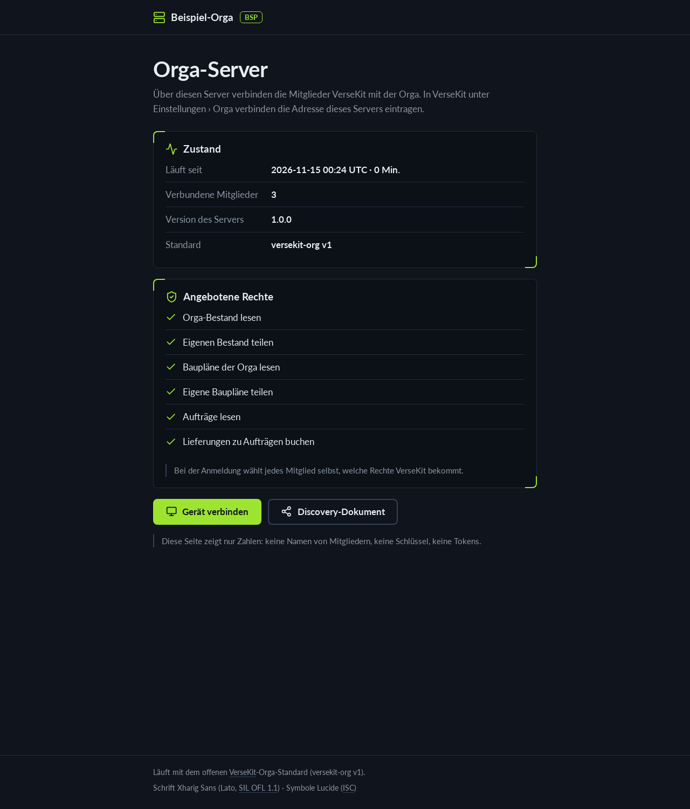
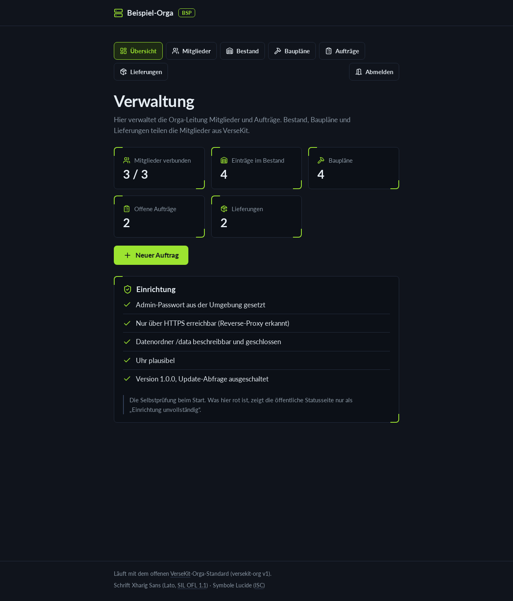

<!-- SPDX-License-Identifier: GPL-3.0-only -->

# Orga-Server selbst hosten – Schritt für Schritt

Diese Anleitung ist für Orgas ohne eigenes Panel und für Leute, die so etwas zum ersten Mal einrichten. Am Ende läuft der VerseKit-Orga-Server bei euch, eure Mitglieder verbinden VerseKit mit ihm, und die Orga-Leitung verwaltet ihn im Browser. English: [selbst-hosten.en.md](selbst-hosten.en.md).

Habt ihr schon ein eigenes Panel mit Datenbank, braucht ihr diesen Server nicht: Baut den offenen Standard in euer Panel ein, siehe [README.md](README.md#eigenes-panel-anbinden).

## Was du brauchst

- Einen Rechner, der dauerhaft läuft und Docker kann: einen kleinen Mietserver (ab etwa 4 € im Monat), eine NAS (UGREEN, Synology) oder Unraid. amd64 und arm64 gehen beide.
- Eine Domain oder Subdomain, etwa `orga.eure-seite.de`, die ihr auf diesen Rechner zeigen lassen könnt.
- Etwa 30 Minuten.

Der Server ist ab Werk sicher eingestellt. Das Admin-Passwort erzeugt er beim ersten Start selbst. Ohne HTTPS startet er nur im ausdrücklichen Testbetrieb. Ihr müsst nichts abschalten, nur eintragen, was gefragt ist.

## Weg A: Mietserver mit Caddy (empfohlen)

Caddy steht vor dem Orga-Server und holt das HTTPS-Zertifikat selbst. Ihr kümmert euch um keine Zertifikate.

1. **Domain zeigen lassen.** Beim Anbieter der Domain einen A-Eintrag (IPv4) und, wenn der Server eine hat, einen AAAA-Eintrag (IPv6) für `orga.eure-seite.de` auf die Adresse des Mietservers anlegen.
   *Das solltest du jetzt sehen:* `ping orga.eure-seite.de` antwortet mit der Adresse eures Servers (das kann einige Minuten dauern).
2. **Docker installieren.** Auf dem Mietserver (Debian oder Ubuntu): `curl -fsSL https://get.docker.com | sh`.
   *Das solltest du jetzt sehen:* `docker compose version` nennt eine Version.
3. **Ordner anlegen und Dateien holen.** `mkdir orga && cd orga`, dann [`docker-compose.caddy.yml`](docker-compose.caddy.yml) und [`config.example.json`](/crates/versekit-orgserver/config.example.json) hineinlegen; die zweite in `config.json` umbenennen.
4. **Eintragen.**
   - Eine Datei `.env` mit der Zeile `VERSEKIT_ORG_DOMAIN=orga.eure-seite.de` anlegen.
   - In `docker-compose.caddy.yml` Name und Kürzel der Orga eintragen.
   - In `config.json` je Mitglied eine `id`, einen Namen und einen eigenen Schlüssel aus mindestens 16 zufälligen Zeichen. Einen Schlüssel erzeugt `openssl rand -base64 18`. Jedes Mitglied bekommt nur seinen eigenen Schlüssel. Die beiden Beispielmitglieder der Vorlage haben absichtlich keinen Schlüssel: Ersetzt sie durch eure eigenen, sonst startet der Server nicht.
   - Die Dateien nur für euch lesbar machen: `chmod 600 .env`, dann `sudo chown 65532:65532 config.json && sudo chmod 600 config.json` (65532 ist der Benutzer, als der der Orga-Server im Container läuft). In `config.json` stehen die Schlüssel aller Mitglieder im Klartext.
5. **Starten.** `docker compose -f docker-compose.caddy.yml up -d`.
   *Das solltest du jetzt sehen:* `docker compose -f docker-compose.caddy.yml ps` zeigt beide Container mit „running“, der Orga-Server nach einer halben Minute mit „healthy“.
6. **Statusseite öffnen.** Im Browser `https://orga.eure-seite.de`.
   *Das solltest du jetzt sehen:* die Statusseite mit dem Namen eurer Orga und dem Schloss im Browser.
   
7. **Admin-Passwort holen.** `docker compose -f docker-compose.caddy.yml exec orgserver versekit-orgserver --admin-password`. Das Passwort in einem Passwort-Manager ablegen.
8. **Verwaltung öffnen.** `https://orga.eure-seite.de/admin`, Passwort eingeben.
   *Das solltest du jetzt sehen:* die Übersicht mit der Karte „Einrichtung“, alle Punkte grün.
   
9. **Mit VerseKit verbinden.** In VerseKit unter **Einstellungen › Orga verbinden** die Adresse `https://orga.eure-seite.de` eintragen, den Code auf der Bestätigungsseite mit dem eigenen Schlüssel freigeben.
   *Das solltest du jetzt sehen:* VerseKit zeigt „Verbunden mit … als …“, die Verwaltung zählt ein verbundenes Mitglied.

## Weg B: NAS oder Unraid

Eine NAS steht meist zu Hause hinter dem Router. Damit Mitglieder von außen herankommen, braucht es HTTPS und eine Weiterleitung im Router – und zwar nur für Caddy, nie für den Orga-Server selbst.

- **Mit Caddy auf der NAS:** `docker-compose.caddy.yml` wie in Weg A nehmen. Im Router die Ports 80 und 443 auf die NAS weiterleiten. Belegt die NAS selbst schon 80 oder 443, nehmt den Reverse-Proxy der NAS (nächster Punkt).
- **Mit dem Reverse-Proxy der NAS:** `docker-compose.yml` nehmen (der Orga-Server lauscht nur auf `127.0.0.1:8080`) und im Reverse-Proxy der NAS `https://orga.eure-seite.de` auf `http://127.0.0.1:8080` zeigen lassen, mit Zertifikat von Let's Encrypt. Dafür leitet der Router 443 auf die NAS weiter, und der Webserver der NAS antwortet aus dem Internet. Achtet darauf, dass dann nur `orga.eure-seite.de` erreichbar ist und nie die Anmeldeseite der NAS selbst (Firewall-Regel der NAS, eigener Host-Name), und schaltet für die Konten der NAS die Zwei-Faktor-Anmeldung ein.
- **Ordner der NAS:** Legt den Ordner mit `config.json` und `.env` nicht in eine Freigabe, auf die andere Nutzer per Dateimanager oder Netzlaufwerk zugreifen.

### UGREEN (UGOS)

1. In der App **Docker** unter **Projekt** ein neues Projekt anlegen, als Ordner einen eigenen, leeren Ordner wählen.
2. Den Inhalt von `docker-compose.caddy.yml` als Compose-Datei einfügen. UGOS liest nur `docker-compose.yaml`; legt ihr die Dateien von Hand ab, heißt die Datei so.
3. `config.json` und `.env` in denselben Ordner legen (Dateimanager der NAS).
4. Projekt starten. *Das solltest du jetzt sehen:* beide Container laufen, der Orga-Server zeigt „healthy“.

### Synology (Container Manager)

1. **Container Manager › Projekt › Erstellen**, Projektname `versekit-orga`, eigenen Ordner wählen.
2. „docker-compose.yml erstellen“ und den Inhalt von `docker-compose.caddy.yml` oder `docker-compose.yml` einfügen.
3. `config.json` und `.env` mit der File Station in den Ordner legen.
4. Mit dem Reverse-Proxy von DSM (**Systemsteuerung › Anmeldeportal › Erweitert › Reverse Proxy**): Quelle `HTTPS`, `orga.eure-seite.de`, Port 443; Ziel `HTTP`, `localhost`, Port 8080. Unter „Benutzerdefinierte Kopfzeile“ nichts weiter nötig.

### Unraid

1. Das Plugin **Docker Compose Manager** aus den Community Applications installieren.
2. Im Reiter **Docker** unter „Compose“ einen neuen Stack anlegen, den Inhalt von `docker-compose.caddy.yml` einfügen, `config.json` und `.env` in den Ordner des Stacks legen.
3. **Compose Up**. *Das solltest du jetzt sehen:* beide Container laufen.

> Die Klickwege oben beschreiben UGOS, Synology DSM 7.2 und Unraid mit Compose Manager; je nach Version heißen Menüpunkte leicht anders.

## Mitglieder eintragen und entfernen

Mitglieder stehen in `config.json`: `id` (fest, nie ändern), Name, Schlüssel. Nach einer Änderung `docker compose up -d --force-recreate orgserver`. Wer aus `config.json` verschwindet, kann sich nicht mehr anmelden. In der Verwaltung trennt „Verbindung trennen“ nur die laufende Anmeldung; mit seinem Schlüssel kann sich das Mitglied neu anmelden.

## Mitglieder-Portal mit Discord (ab 1.1.0)

Im Portal unter `https://orga.eure-seite.de/portal` sehen eure Mitglieder im Browser Bestand, Baupläne, Aufträge und Lieferungen der Orga. Sie melden sich mit ihrem Discord-Konto an. Hinein kommt nur, wer auf dem Discord-Server eurer Orga ist und eine Rolle im Portal hat. VerseKit selbst verbindet sich weiter wie oben mit Code und Schlüssel; daran ändert das Portal nichts.

Ohne die drei Discord-Einstellungen ist das Portal aus. Ihr müsst es nicht einschalten.

### Wer darf was

| Rolle | Darf |
|---|---|
| Mitglied | Bestand, Baupläne, Aufträge und Lieferungen ansehen |
| Logistik | dazu Aufträge anlegen, bearbeiten und schließen, Lieferungen bestätigen |
| Leitung | alles, dazu verbundene Mitglieder trennen, Zugang zum Portal vergeben, Einstellungen |

Das Admin-Passwort unter `/admin` bleibt der Notzugang: für die Einrichtung und wenn Discord klemmt. Es darf alles, was die Leitung darf.

### Schritt 1: Discord-App anlegen

Die App gehört eurer Orga. Sie ist nur für die Anmeldung da, sie braucht keinen Bot.

1. Im Browser <https://discord.com/developers/applications> öffnen und mit dem Discord-Konto der Orga-Leitung anmelden.
2. **New Application**, als Namen etwa den Namen eurer Orga eintragen, den Bedingungen zustimmen, **Create**.
   *Das solltest du jetzt sehen:* die Seite **General Information** eurer neuen App.
3. Links **OAuth2** öffnen.
4. Unter **Redirects** auf **Add Redirect** und genau diese Adresse eintragen (eure Domain statt `orga.eure-seite.de`), dann **Save Changes**:
   `https://orga.eure-seite.de/portal/callback`
   Sie muss Zeichen für Zeichen stimmen: `https`, kein Schrägstrich am Ende. Die Verwaltung zeigt sie unter **Einstellungen › Weiterleitungs-Adresse** zum Abschreiben.
5. Auf derselben Seite die **Client ID** kopieren (**Copy**).
6. Unter **Client Secret** auf **Reset Secret**, bestätigen, das Geheimnis kopieren. Discord zeigt es nur dieses eine Mal. Es gehört nur in die Datei `.env`, nie in einen Chat.
7. **Public Client** bleibt aus. Scopes müsst ihr nirgends anklicken: Der Server fragt selbst nur `identify` (wer bist du) und `guilds.members.read` (bist du auf unserem Server, welche Rollen hast du).

> Die Menünamen des Discord-Entwicklerportals sind vom November 2026 und auf Englisch; Discord ändert sie gelegentlich.

### Schritt 2: Server-ID und Rollen-IDs holen

1. In Discord unten links das Zahnrad (**Nutzereinstellungen**, englisch **User Settings**) › **Erweitert** (**Advanced**) › **Entwicklermodus** (**Developer Mode**) einschalten.
2. Rechtsklick auf das Symbol eures Orga-Servers in der linken Leiste › **Server-ID kopieren** (**Copy Server ID**).
3. Für die Rollen: **Servereinstellungen › Rollen**, Rechtsklick auf eine Rolle › **Rollen-ID kopieren** (**Copy Role ID**). Merkt euch je eine Rolle für Mitglied, Logistik und Leitung (oder mehrere).

### Schritt 3: In die Datei `.env` eintragen und neu starten

Drei Zeilen in die Datei `.env` neben der Compose-Datei, mit euren Werten:

```
VERSEKIT_ORG_DISCORD_CLIENT_ID=123456789012345678
VERSEKIT_ORG_DISCORD_CLIENT_SECRET=das-geheimnis-aus-schritt-1
VERSEKIT_ORG_DISCORD_GUILD_ID=876543210987654321
```

Dann `docker compose up -d` (mit Caddy: `docker compose -f docker-compose.caddy.yml up -d`). Die Vorlagen reichen die drei Werte schon an den Orga-Server weiter.

*Das solltest du jetzt sehen:* Die Statusseite hat einen Knopf **Mitglieder-Portal**. Fehlt einer der drei Werte, startet der Server nicht und nennt im Log, welcher fehlt.

### Schritt 4: Rollen zuordnen

1. `https://orga.eure-seite.de/admin` mit dem Admin-Passwort öffnen, Reiter **Einstellungen**.
2. Unter **Rollen aus Discord** die Rollen-IDs aus Schritt 2 eintragen: bei Leitung, Logistik und Mitglied je eine oder mehrere, mit Leerzeichen getrennt. Wer mehrere Rollen hat, bekommt die höchste. **Speichern**.
3. Den Haken **Jedes Mitglied des Discord-Servers ist Mitglied im Portal** nur setzen, wenn auf eurem Discord-Server keine Gäste sind. Sonst sehen auch Gäste Bestand und Baupläne.

*Das solltest du jetzt sehen:* In der Karte **Einrichtung** der Übersicht steht „Mitglieder-Portal an“ in Grün.

### Schritt 5: Anmelden

Jeder öffnet `https://orga.eure-seite.de/portal`, klickt **Mit Discord anmelden** und bestätigt bei Discord. Danach sieht er die Seiten, die seine Rolle erlaubt. Die Leitung meldet sich ab jetzt ebenso mit Discord an.

Wer noch keine passende Rolle hat, sieht „noch nicht freigeschaltet“. Die Leitung findet ihn unter **Zugang** und vergibt dort eine Rolle von Hand, oder gibt ihm in Discord die passende Rolle (gilt ab seiner nächsten Anmeldung).

### Zugang verwalten

- **Zugang** zeigt jeden, der sich angemeldet hat, mit Rolle, Herkunft der Rolle und letzter Anmeldung.
- **Von Hand** lässt sich jede Rolle setzen. **Gesperrt** hält jemanden draußen, was Discord auch sagt, und wirkt sofort, auch in einer offenen Sitzung.
- **Vergessen** löscht den Eintrag. Meldet sich die Person wieder an, steht sie wieder da; wer draußen bleiben soll, bleibt besser gesperrt.
- Die eigene Rolle ändert eine andere Person der Leitung oder der Notzugang.
- Eine Anmeldung gilt höchstens 8 Stunden und endet nach 2 Stunden ohne Klick. Neue Rollen in Discord gelten ab der nächsten Anmeldung.

### Was das Portal von Discord behält

Nur die Discord-ID, den Anzeigenamen, den Benutzernamen, die Rollen-IDs auf eurem Server und die Zeit der ersten und letzten Anmeldung, in `state.json` im Datenordner. Den Zugangsschlüssel von Discord nutzt der Server einmal für die Frage nach der Mitgliedschaft und gibt ihn sofort zurück. Wer nicht auf eurem Server ist, wird gar nicht gespeichert.

### Zum Ausprobieren ohne HTTPS

Im Testbetrieb (`VERSEKIT_ORG_TESTBETRIEB: "1"`, Adresse `http://127.0.0.1:8080`) läuft das Portal auch ohne HTTPS. In der Discord-App tragt ihr dann `http://127.0.0.1:8080/portal/callback` als zweite Weiterleitung ein. Nie für echte Mitglieder.

## Aktuell halten

Die Vorlagen nutzen das Image `ghcr.io/xharig/versekit-orgserver:1`. `:1` bekommt jedes Update der Reihe 1 (neue Funktionen, Fehlerbehebungen), aber nie eine Version 2, die etwas bricht. Wer jede Änderung von Hand bestätigen will, trägt eine feste Version ein, etwa `:1.1.0`. `:latest` folgt immer der neuesten Version, auch über einen Sprung auf 2 hinweg; das empfehlen wir nicht.

Die Verwaltung zeigt „Update verfügbar: x.y.z“ mit einem Link zu den Änderungen. Dazu fragt der Server höchstens einmal am Tag bei GitHub nach den Tags `orgserver-v…`, ohne etwas über eure Orga zu senden; GitHub sieht dabei nur die Adresse eures Servers und seine Version. `VERSEKIT_ORG_UPDATE_CHECK: "0"` schaltet das ab.

- **Befehl:** `docker compose pull && docker compose up -d`.
- **UGOS:** In der App Docker beim Projekt das Image neu ziehen und das Projekt neu starten; je nach Version bietet UGOS dafür einen eigenen Knopf oder automatische Updates an.
- **Synology:** **Container Manager › Projekt**, Projekt wählen, **Aktion › Erstellen** zieht das neue Image (vorher **Image › Aktualisieren**, wenn angezeigt).
- **Unraid:** Im Compose Manager **Update Stack**.
- **Portainer:** **Stacks**, Stack wählen, **Update the stack** mit „Re-pull image“.
- **Watchtower (optional):** Wer Watchtower schon nutzt, gibt dem Orga-Server das Label `com.centurylinklabs.watchtower.enable: "true"` und startet Watchtower mit `--label-enable`; dann aktualisiert es nur Container mit diesem Label.

**Daten ziehen selbst um.** Braucht eine neue Version ein neues Datenformat, sichert der Server beim Start zuerst nach `backup-<zeit>/` im Datenordner und zieht dann um. Das Log nennt beides.

**Von 1.0.0 auf 1.1.0:** Das Datenformat steigt auf 3. Nach dem ersten Start mit 1.1.0 startet 1.0.0 nicht mehr auf diesen Daten; zurück geht es nur mit der Sicherung, die das Update anlegt.

**Zurück auf die alte Version.** In der Compose-Datei die alte Version festnageln (etwa `:1.0.0`). Erkennt sie die neueren Daten nicht, startet sie nicht und sagt im Log warum. Dann die Sicherung zurückspielen (siehe unten, die Sicherung `backup-<zeit>/` vom Update nehmen) und `docker compose up -d`.

## Sicherung und Wiederherstellung

- **Sichern:** `docker compose cp -a orgserver:/data ./sicherung-$(date +%F)`. Dazu `config.json` und `.env` aufheben.
- **Zurückspielen:** `docker compose stop orgserver`, dann `docker compose cp -a ./sicherung-2026-11-14/. orgserver:/data`, dann `docker compose start orgserver`. `-a` behält Besitzer und Rechte, damit der Server seine Dateien wieder lesen kann.
- **Mit Caddy (Weg A):** In jedem Befehl `-f docker-compose.caddy.yml` hinter `docker compose` setzen, auch bei `pull` und `up`.

Die Sicherung enthält das Admin-Passwort, die Anmeldungen (nur als Hash) und die Namen und Rollen-IDs aus dem Portal. Legt sie dorthin, wo nur ihr herankommt.

## Herkunft des Images prüfen

Jedes Image entsteht auf GitHub aus dem öffentlichen Quelltext und trägt einen Herkunftsnachweis. Prüfen mit der GitHub-Kommandozeile: `gh attestation verify oci://ghcr.io/xharig/versekit-orgserver:1 --repo Xharig/VerseKit`. *Das solltest du sehen:* „Verification succeeded“.

## Fehlerhilfe

| Was du siehst | Woran es liegt | Was hilft |
|---|---|---|
| Im Log: `public_url is http: only in the test mode` | Die Adresse beginnt mit `http://`. | `https://` eintragen. Nur zum Ausprobieren auf dem eigenen Rechner: `VERSEKIT_ORG_TESTBETRIEB: "1"`. |
| Im Browser: „Dieser Server antwortet nur über HTTPS“ | Ihr ruft den Server ohne Reverse-Proxy auf, oder der Proxy meldet HTTPS nicht. | Über `https://` aufrufen. Bei nginx `proxy_set_header X-Forwarded-Proto $scheme;` ergänzen. |
| Statusseite: „Einrichtung unvollständig“ | Die Selbstprüfung hat einen Mangel gefunden. | In der Verwaltung zeigt die Karte „Einrichtung“, was rot ist und warum. |
| Caddy: kein Zertifikat | Die Domain zeigt noch nicht auf den Server, oder Port 80/443 ist zu. | `ping` prüfen, Ports im Router oder in der Firewall des Anbieters öffnen. |
| Im Log: `state.json has format …, this server … knows formats up to …` | Ein älteres Image läuft auf neueren Daten. | Das neuere Image starten oder die Sicherung vom Update zurückspielen. |
| Im Log: `cannot read config.json` | `config.json` fehlt oder liegt woanders. | Datei neben die Compose-Datei legen, Name genau so. |
| VerseKit: „Der Schlüssel stimmt nicht“ | Falscher Schlüssel beim Bestätigen. | Den Schlüssel aus `config.json` nehmen; nach fünf Fehlern gilt der Code nicht mehr, neu verbinden. |
| Verwaltung: „Zu viele falsche Passwörter“ | Fünf falsche Passwörter. | Warten (eine Minute, danach länger, höchstens 15 Minuten), dann das Passwort mit `--admin-password` holen. Hört es nicht auf, probiert es jemand anderes: `docker compose restart orgserver` hebt die Sperre auf, danach die Log-Datei des Reverse-Proxys ansehen. |
| Im Log: `the portal needs all three Discord settings, missing: …` | In `.env` fehlt eine der drei Discord-Zeilen. | Die genannte Zeile ergänzen oder alle drei herausnehmen (dann bleibt das Portal aus). |
| Bei Discord: „Invalid OAuth2 redirect_uri“ | Die Weiterleitung in der Discord-App passt nicht genau. | Die Adresse aus **Einstellungen › Weiterleitungs-Adresse** in der Discord-App unter **OAuth2 › Redirects** eintragen, Zeichen für Zeichen. |
| Portal: „Discord hat die Anmeldung nicht bestätigt“ | Meist ein falsches oder zurückgesetztes Client Secret. | Im Log steht der Grund. Secret in der Discord-App neu setzen, in `.env` eintragen, neu starten. |
| Portal: „nicht auf dem Discord-Server der Orga“ | Die Person ist nicht auf eurem Server, oder sie hat dessen Regeln noch nicht angenommen; oder die Server-ID stimmt nicht. | Einladen, Regeln annehmen lassen; `VERSEKIT_ORG_DISCORD_GUILD_ID` prüfen. |
| Portal: „Gerade melden sich zu viele an“, über längere Zeit | Jemand ruft die Anmeldung massenhaft auf (höchstens 500 offene Anmeldungen in 10 Minuten). | Im Log des Reverse-Proxys nachsehen; dort `/portal/login` bremsen (etwa Cloudflare-Regel). `docker compose restart orgserver` leert die Warteschlange. |
| Portal: „noch nicht freigeschaltet“ | Keine ihrer Discord-Rollen ist zugeordnet. | Unter **Zugang** eine Rolle von Hand geben oder unter **Einstellungen** die Rolle zuordnen. |
| Im Log: `the key of member m1 is shorter than 16 characters` | Ein Mitglied hat keinen eigenen Schlüssel, etwa ein Beispielmitglied der Vorlage. | Einen Schlüssel mit `openssl rand -base64 18` erzeugen und eintragen, oder das Mitglied löschen. |

## Was du nie tun solltest

- **Den Port 8080 ins Internet freigeben.** Der Orga-Server spricht nur HTTP. Freigegeben wird höchstens Caddy (80 und 443), nie der Orga-Server.
- **Den Testbetrieb für echte Mitglieder nutzen.** `VERSEKIT_ORG_TESTBETRIEB` ist nur zum Ausprobieren auf dem eigenen Rechner.
- **Das Admin-Passwort teilen oder in einen Chat schreiben.** Jede Person der Orga-Leitung bekommt es nur persönlich, am besten über einen Passwort-Manager.
- **Einem Mitglied den Schlüssel eines anderen geben.** Jeder Schlüssel gehört genau einem Mitglied.
- **Das Client Secret der Discord-App weitergeben.** Wer es hat, kann sich als eure App ausgeben. Ist es doch draußen: in der Discord-App **Reset Secret**, neu in `.env`, neu starten.
- **„Jedes Mitglied des Discord-Servers“ einschalten, wenn Gäste auf dem Server sind.** Dann sehen auch sie Bestand und Baupläne.
- **Den Datenordner oder Sicherungen öffentlich ablegen** (Cloud-Freigabe, Webordner). Darin liegen Passwort und Anmeldungen.
- **Den Docker-Socket in einen Container hängen** (`/var/run/docker.sock`), außer für ein Werkzeug, dem ihr voll vertraut.
